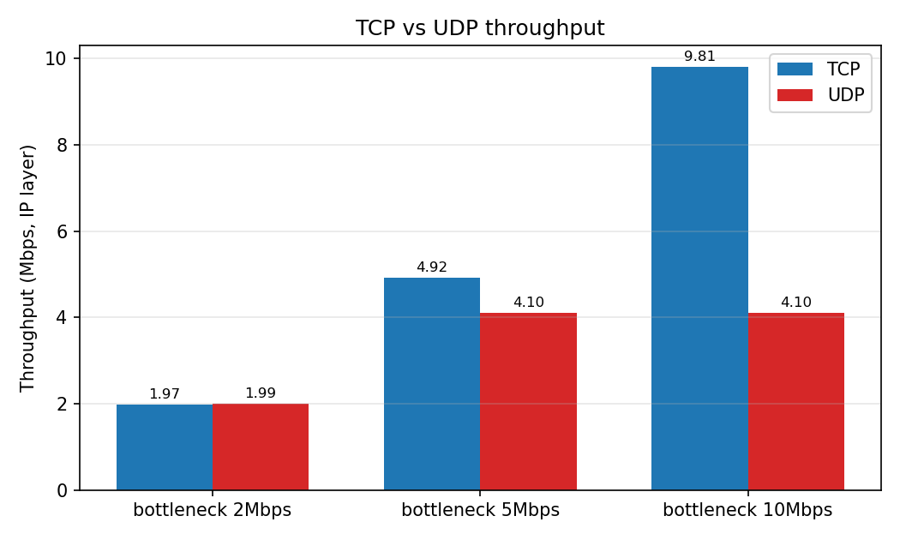
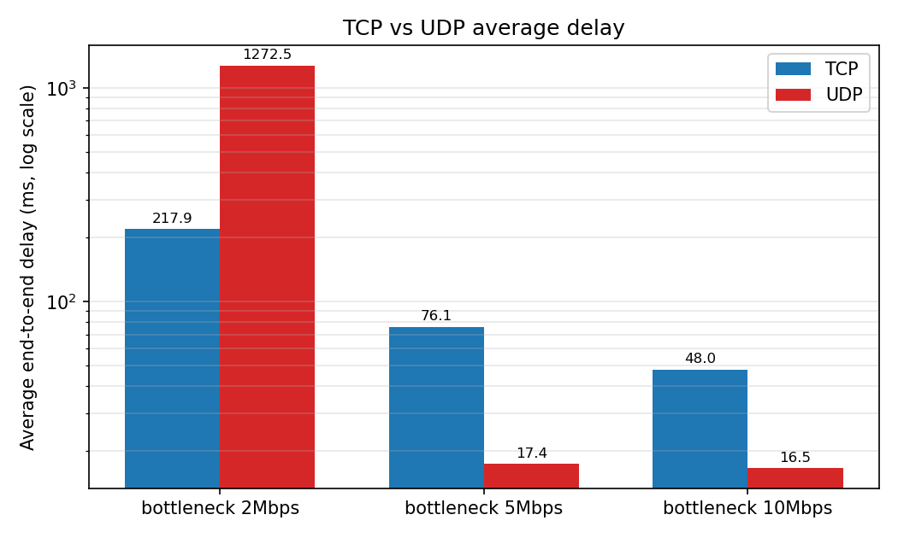
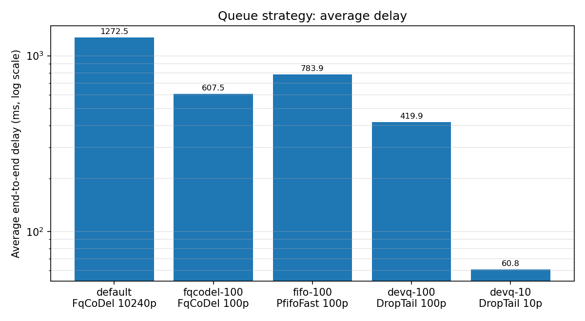
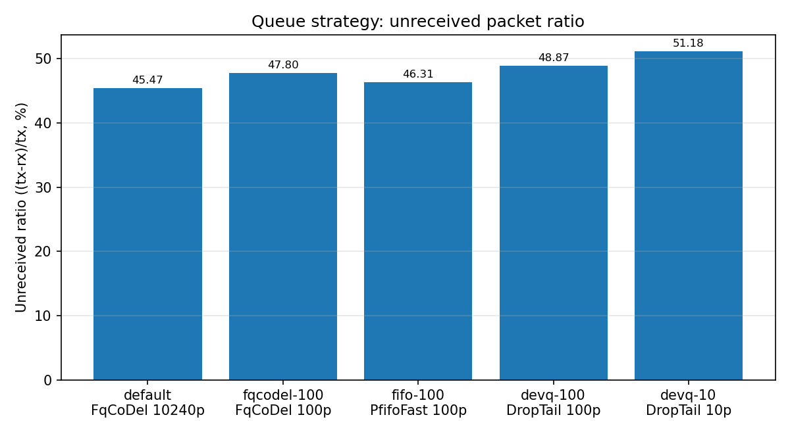

# telecom-network-simulator

**基于 ns-3 的通信网络性能仿真与故障分析** —— 在受控瓶颈链路拓扑上，对比 TCP/UDP 的吞吐量、丢包与时延，并用多层计数器交叉验证测量工具本身。


📄 求职材料：[面试问答（10 个技术追问）](docs/interview.md) · [简历项目描述](docs/resume.md)

## 项目概览

- **建模**：四节点点对点拓扑（两端 10 Mbps、中间可调瓶颈链路），TCP 用 BulkSend、UDP 用 OnOff（恒定 4 Mbps），IPv4 全局路由，仿真 10 s。
- **测量**：同一流量双口径测量——FlowMonitor（IP 层逐流统计）+ PacketSink（应用层），并采集队列丢弃计数与占用深度做交叉验证。
- **自动化**：Python 脚本一键运行实验矩阵（协议×带宽 6 组、队列配置 5 组），自动校验并生成 CSV 与对比图；最终回归 14 项全部 PASS，结果逐行可复现。

## 核心成果

1. **TCP/UDP 瓶颈性能矩阵**：2 Mbps 瓶颈下 TCP 丢包仅 0.22%、吞吐 1.9747 Mbps；UDP 丢包 44.62%。瓶颈 ≥5 Mbps 后 UDP 不再拥塞，吞吐被自身 4 Mbps 发送速率封顶。
2. **定位一次吞吐量统计偏差**：应用层口径曾算出 UDP 吞吐 2.1811 Mbps（超过瓶颈），用 FlowMonitor 首末包时刻复核为 1.9927 Mbps——偏差来自固定 8 s 统计窗口与实际 8.9958 s 接收跨度之差。
3. **队列与 bufferbloat 定量分析**：证明瓶颈出口是 QueueDisc + 设备队列两层串联缓冲；默认配置平均时延 1272.5 ms，把设备队列压到 10 包后降至 60.8 ms（时延降为 1/21，代价是未接收比例约 +5 个百分点，吞吐不变）。

## 技术亮点

### 亮点 1：吞吐量"超过瓶颈"的统计偏差定位

- **现象**：载荷字节 ÷ 固定 8 s 窗口 = 2.1811 Mbps，物理上不可能超过 2 Mbps 瓶颈。
- **定位**：改用 FlowMonitor 记录的首包发送/末包接收时刻，真实接收跨度 8.9958 s（多出的近 1 s 是队列积压的排空时间）；同时区分统计层级——同一批 2130 个包，IP 层字节（含 28 B/包头）与应用层载荷字节相差 2.7%。
- **结论**：IP 层吞吐 1.9927 Mbps 与瓶颈吻合。**报告吞吐必须注明统计层级与时间窗口**，否则数字不可比。

### 亮点 2：双层队列 Bufferbloat 分析

- **现象**：默认 FqCoDel 配置下，已交付 UDP 包平均时延高达 1272.5 ms（无拥塞基线仅 16.5 ms）。
- **定位**：从协议栈读回实际配置并以 10 ms 间隔采样两层队列占用——流量控制层 FqCoDel 默认上限 10240 包（平均占用 367、峰值 617），其下还串联着 100 包的设备 DropTail 队列（平均占用 87 包，纯 FIFO，不受 AQM 控制）。
- **结论**：FqCoDel 在自身队列内有效（上限压到 100 包后占用峰值 617→100、时延 608 ms，优于同尺寸 FIFO 的 784 ms）；**系统时延由两层总缓冲决定**，单层 100 包配置（420 ms）反而优于双层 100 包。队列策略在持续过载下只做时延↔丢包权衡，吞吐恒由瓶颈带宽决定。

### 亮点 3：FlowMonitor 丢包统计盲区的发现与对账

- **现象**：卸载 QueueDisc 的配置下，FlowMonitor 的 `lostPackets` 读数为 **0**，但发送 3906 包只收到 1997 包。
- **定位**：用三层独立计数对账——qdisc 丢弃计数、设备队列丢弃计数、仿真结束时队列残留。证实丢弃发生在包被设备队列接收之前（设备队列接收数恰等于链路服务量、自身丢弃 0、结束残留 0），该路径不产生可追踪的丢弃事件。
- **结论**：`lostPackets` 与队列丢弃计数的对应关系**有条件成立**（有 qdisc 时逐组精确相等：1743/1867/1809）。使用任何监控指标前，必须先确认其观测点覆盖实际故障位置；`tx−rx` 只能称"未接收"，须拆分为已确认丢弃、结束残留、在途三部分（本项目已逐组闭合对账）。

## 关键图表

TCP 与 UDP 吞吐量随瓶颈带宽变化（UDP 被 4 Mbps 发送速率封顶，TCP 随瓶颈近线性增长）：



平均端到端时延（对数轴）：拥塞只发生在 2 Mbps 瓶颈处，UDP 无拥塞控制导致秒级排队时延：



队列策略对时延的影响（固定过载：UDP 4 Mbps → 2 Mbps 瓶颈）：



## 网络拓扑

```
 发送端 n0 ──10Mbps/2ms── 转发 n1 ──B Mbps/10ms── 转发 n2 ──10Mbps/2ms── 接收端 n3
 (BulkSend /               瓶颈链路                  (PacketSink :9000)
  OnOff 4Mbps)             10.1.2.0/24

 子网: n0-n1 = 10.1.1.0/24 · n1-n2 = 10.1.2.0/24 · n2-n3 = 10.1.3.0/24
 B = 瓶颈带宽 (--bottleneck)，实验取 2 / 5 / 10 Mbps
 仿真 10 s: 发送端 1.0 s 启动、9.0 s 停止
```

瓶颈出口（n1→n2）的排队路径是两层串联，这是 D5 的关键结构：

```
 IP 转发 ──► QueueDisc (FqCoDel / PfifoFast / 无) ──► 设备队列 (DropTail) ──► 瓶颈链路
              流量控制层，可配置上限                     PointToPoint 设备自带，默认 100 包
```

## 快速开始

环境（Ubuntu 24.04，系统包安装 ns-3 3.41，不编译 ns-3 本体）：

```bash
apt-get install -y --no-install-recommends ns3 libns3-dev
# 链接时还需以下两个包提供 .so 符号链接（当前软件包环境下 libns3-dev 未一并带入）
apt-get install -y libsqlite3-dev libgsl-dev
```

编译（任选目标）：

```bash
cd telecom-network-simulator
PKGS="ns3-core ns3-network ns3-internet ns3-point-to-point ns3-applications"
g++ -std=c++17 -O0 -g0 src/udp_baseline.cc    -o udp_baseline    $(pkg-config --cflags --libs $PKGS)
g++ -std=c++17 -O0 -g0 src/tcp_udp_compare.cc -o tcp_udp_compare $(pkg-config --cflags --libs $PKGS)
g++ -std=c++17 -O0 -g0 src/flow_metrics.cc    -o flow_metrics    $(pkg-config --cflags --libs $PKGS ns3-flow-monitor ns3-traffic-control)
g++ -std=c++17 -O0 -g0 src/queue_compare.cc   -o queue_compare   $(pkg-config --cflags --libs $PKGS ns3-flow-monitor ns3-traffic-control)
```

一键复现全部结果：

```bash
./udp_baseline                        # D1: 输出 UDP packets received: 100
python3 scripts/run_experiments.py    # D4: 6 组矩阵 + 校验 -> results/d4_metrics.csv
python3 scripts/plot_results.py       # D4: 对比图 -> results/figures/
python3 scripts/run_queue_experiments.py   # D5: 5 组队列实验 -> results/d5_metrics.csv
python3 scripts/plot_queue_results.py      # D5: 对比图
bash scripts/run_regression.sh        # D6: 最终回归（14 项），清单见 results/final_regression.txt
```

技术栈：ns-3 3.41（C++17 离散事件仿真）· g++ + pkg-config · Python 3（自动化/校验）· matplotlib 3.6.3 · Git

## 目录结构

```
src/        C++ 仿真源码（D1-D5）
scripts/    自动化实验、绘图与回归脚本（D4-D6）
results/    实验输出：txt 记录、CSV 指标、figures/ 对比图、回归清单
docs/       面试问答（interview.md）与简历材料（resume.md）
```

## 实验设计

- **控制变量**：每组实验只改变一个因素——D4 改变协议与瓶颈带宽，D5 固定负载（UDP 4 Mbps → 2 Mbps 瓶颈）只改变瓶颈出口的队列配置。
- **双层测量**：同一流量同时用 FlowMonitor（IP 层）与 PacketSink（应用层）测量，并用队列计数器交叉验证丢包位置（见"指标定义"）。
- **确定性**：ns-3 默认随机种子下结果逐次运行完全一致，D4/D6 的校验与回归均包含"重跑后逐行比对"。

## 单组运行（可选）

```bash
./tcp_udp_compare --protocol=tcp --bottleneck=2Mbps           # D2
./flow_metrics --protocol=udp --bottleneck=2Mbps \
    --csvfile=results/d3_metrics.csv                          # D3
./queue_compare --scenario=fqcodel100 \
    --csvfile=results/d5_metrics.csv                          # D5 单场景
```

## 指标定义

数据来源有两层，**不可混用**：

- **FlowMonitor（IP 层）**：按五元组统计每条流的 `txPackets`、`rxPackets`、`lostPackets`、`rxBytes`（含 IP/传输层头部）、`delaySum`、`jitterSum`，以及首/末包收发时刻。
  - 丢包率 = lostPackets / txPackets × 100%
  - 平均时延 = delaySum / rxPackets
  - IP 层吞吐量 = rxBytes × 8 / (末包接收时刻 − 首包发送时刻)
  - TCP 存在独立的反向 ACK 流；数据流的 txPackets 包含重传报文段。
- **PacketSink（应用层）**：只统计应用载荷字节数。D2 曾用"载荷字节 / 固定 8 s 发送窗口"计算吞吐，得到 UDP 在 2 Mbps 瓶颈下 2.1811 Mbps 的反常结果；D3 用 FlowMonitor 的实际收发跨度（8.9958 s）复核后 IP 层吞吐为 1.9927 Mbps，与瓶颈吻合。**教训：吞吐量数值依赖统计窗口与统计层级，报告时必须注明口径。**

## 主要结果（D4，6 组）

| 协议 | 瓶颈 | 发送 | 接收 | 丢失 | 丢包率 | 平均时延 | IP 层吞吐 |
|---|---|---|---|---|---|---|---|
| TCP | 2 Mbps | 3617 | 3609 | 8 | 0.22% | 217.85 ms | 1.9747 Mbps |
| TCP | 5 Mbps | 8627 | 8624 | 3 | 0.03% | 76.09 ms | 4.9196 Mbps |
| TCP | 10 Mbps | 16954 | 16952 | 2 | 0.01% | 47.96 ms | 9.8069 Mbps |
| UDP | 2 Mbps | 3906 | 2130 | 1743 | 44.62% | 1272.51 ms | 1.9927 Mbps |
| UDP | 5 Mbps | 3906 | 3906 | 0 | 0% | 17.37 ms | 4.1015 Mbps |
| UDP | 10 Mbps | 3906 | 3906 | 0 | 0% | 16.53 ms | 4.1020 Mbps |

要点：UDP 发送速率恒为 4 Mbps，瓶颈 ≥5 Mbps 时不再拥塞，吞吐被发送速率封顶；瓶颈 2 Mbps 时无拥塞控制的 UDP 丢包 44.62% 且时延被队列积压抬高至秒级，而 TCP 以重传和退让把丢包压在 0.22%。

## D5：队列管理与 bufferbloat 对比

固定负载（UDP 4 Mbps → 2 Mbps 瓶颈），只改变瓶颈出口（n1→n2）的队列配置。每组实验都从协议栈**读回实际生效配置**，并同时采集 QueueDisc 与设备队列两层的丢弃计数和占用深度（10 ms 采样）。

| 场景 | 实际配置（读回） | 吞吐 Mbps | 平均时延 | 未接收比例* | FlowMonitor lostPackets |
|---|---|---|---|---|---|
| default | FqCoDel 10240p + 设备队列 100p | 1.9927 | 1272.51 ms | 45.47% | 1743 |
| fqcodel100 | FqCoDel 100p + 设备队列 100p | 1.9926 | 607.53 ms | 47.80% | 1867 |
| fifo100 | PfifoFast 100p + 设备队列 100p | 1.9927 | 783.88 ms | 46.31% | 1809 |
| devq100 | 无 qdisc + 设备队列 100p | 1.9925 | 419.95 ms | 48.87% | **0（失真）** |
| devq10 | 无 qdisc + 设备队列 10p | 1.9923 | 60.83 ms | 51.18% | **0（失真）** |



\* 未接收比例 = (txPackets − rxPackets) / txPackets。它**不等于**丢包率：未接收的包还包括仿真结束时仍在排队/在途的部分。D6 已对五组逐一对账（已确认丢弃 + 结束时瓶颈队列残留 + 在途/下游残余）：default 组未接收 1776 = qdisc 确认丢弃 1743 + 结束时设备队列残留 29 + 在途 4；fqcodel100 与 fifo100 的未接收与确认丢弃完全相等（残留为 0）；devq 两组残留为 0、确认丢弃为 0，差额见关键发现 4。

关键发现：

1. **排队是两层串联的**。瓶颈出口的有效缓冲 = QueueDisc + 设备队列（DropTail 100p）。默认场景采样显示 qdisc 平均占用 367 包、设备队列平均占用 87 包——设备队列几乎常满，贡献约 0.37 s 的纯 FIFO 排队，**不在任何 AQM 的控制范围内**。
2. **FqCoDel 在自己这一层是有效的，但系统时延由总缓冲决定**。把 FqCoDel 上限从 10240p 压到 100p，其占用峰值从 617 降到 100，时延从 1272 ms 降到 608 ms，且优于同为 100p 的 FIFO（784 ms）；但串联的设备队列使时延地板远高于 CoDel 的目标量级。反直觉的是 devq100（单层 100p）时延 420 ms 反而低于两个"双层 100p"场景——少一层队列就是少一份缓冲。
3. **小队列用丢包换时延，吞吐不变**。devq10 把时延压到 60.8 ms（默认的 1/21），代价是丢包率升至 51.18%（+5.7 个百分点）；五组吞吐全部在 1.992 附近——发送端持续过载时链路永不空闲，吞吐只由瓶颈带宽决定，队列策略只能在时延与丢包之间做权衡。
4. **丢包发生在哪一层，现已可逐组归因**（见"已知限制"第 1 条的更新）：有 qdisc 的三组，qdisc 丢弃计数与 lostPackets 精确相等、设备队列丢弃为 0；无 qdisc 的两组，计数器证实丢弃发生在包被设备队列接收**之前**（设备队列接收数恰等于链路服务量、自身丢弃为 0、结束残留为 0），且不被 FlowMonitor 记录。丢弃点位于流量控制层交付路径是与全部计数证据一致的**推断**——该路径上没有可读的丢弃计数器，未能定位到具体实现函数。

原始数据见 `results/d5_metrics.csv` 与 `results/d5_<scenario>.txt`，吞吐对比图见 `results/figures/d5_throughput.png`。

## 问题排查记录

开发中实际定位并解决的问题（均为先取证、后下结论）：

1. **链接缺库**：`pkg-config` 给出的参数链接失败（缺 `libsqlite3.so`/`libgsl.so` 等符号链接）→ 确认是当前软件包环境的链接依赖未随 `libns3-dev` 一起安装，补装 `libsqlite3-dev`、`libgsl-dev` 解决。
2. **3.41 API 差异 ×2**：`FlowStats` 须写 `FlowMonitor::FlowStats`；`QueueBase` 没有 `GetStats()`，须用 `GetTotalReceivedPackets()` / `GetTotalDroppedPackets()` 等单个计数接口（后者还细分入队前/出队后丢弃）。
3. **吞吐量"超过瓶颈"伪影**：见"指标定义"——固定 8 s 窗口与实际 8.9958 s 接收跨度之差，用 FlowMonitor 首末包时刻定案。
4. **FqCoDel 高时延**：见 D5——根因是默认 10240p 上限 + 串联的 100p 设备队列，而非单一组件失效。
5. **FlowMonitor 丢包盲区**：见"已知限制"第 1 条——无 qdisc 时 `lostPackets` 读 0 而实际丢约半数包，靠三层计数对账发现。

## 已知限制与开放问题

1. **丢包来源对应关系（D5/D6 已核查，结论有条件成立）**：在有 QueueDisc 的场景中，`lostPackets` 与 qdisc 丢弃计数逐组精确相等（1743/1867/1809），且设备队列丢弃恒为 0——该配置下丢包全部发生 在 qdisc 层，对应关系成立。但对应关系**不是无条件的**：卸载 qdisc 后（devq100/devq10），`lostPackets` 读数为 0，而实际约 1900–2000 个包在被设备队列接收之前被丢弃。D6 对账已排除"结束时残留"这一替代解释（两组结束残留实测为 0、末包接收时刻分别早于仿真结束 0.56 s / 0.94 s）；但丢弃点在流量控制层内部的具体位置仍是基于计数器位置的推断，无追踪计数可直接证实。使用 FlowMonitor 丢包指标前，必须先确认丢弃点位于可追踪的队列上。另注意 `tx−rx` 是"未接收"而非"丢弃"，须按 D5 表注的对账方式拆分后使用。
2. **FqCoDel 高时延的原因（D5 已定位，不构成"失效"判定）**：1.27 s 平均时延来自三部分叠加——默认上限 10240p 允许 qdisc 本身积压数百个包（采样峰值 617）；qdisc 之下还串联着 100p 的设备队列（平均占用 87 包，纯 FIFO，不受 CoDel 度量）；过载比 2:1 持续 8 s。压低 FqCoDel 上限后时延显著下降（608 ms）且优于同尺寸 FIFO（784 ms），说明其 AQM 行为在自身队列内有效；系统级时延优化必须同时处理两层缓冲。仍未核查的：FqCoDel 的 Target/Interval 参数在本负载下的丢弃节奏、以及多流场景下公平队列的隔离效果。
3. 实验使用 ns-3 默认随机种子：结果逐次运行完全一致（已校验），但尚未做多随机种子的统计重复性分析。
4. ns-3 的 TCP 默认报文段大小（SegmentSize=536 B）与常见真实系统（MSS 1460 B）不同，TCP 的包级计数受此影响；字节级指标不受影响。
5. 全部结果为离散事件仿真，不等同于真实硬件测量。

## 进度

- D1 两节点 UDP 基线（100/100 接收）✅
- D2 四节点瓶颈拓扑 TCP/UDP 对比 ✅
- D3 FlowMonitor 指标采集 + 统计口径异常定位 ✅
- D4 自动化实验矩阵、校验与可视化 ✅
- D5 队列管理（AQM）与 bufferbloat 专项 ✅
- D6–D7 工程化收尾：最终回归（14 项全 PASS）、README 整理、面试问答与简历材料（docs/）✅
